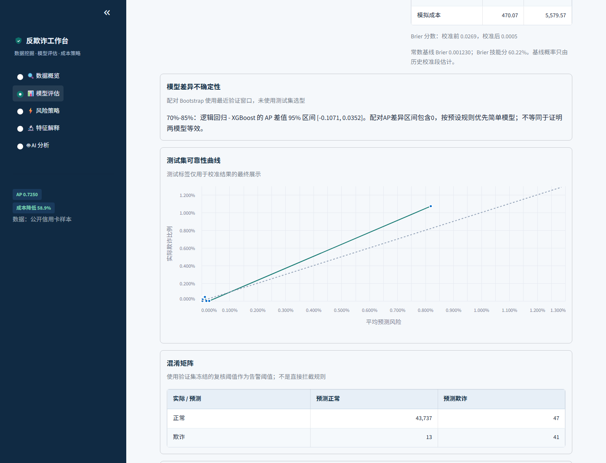
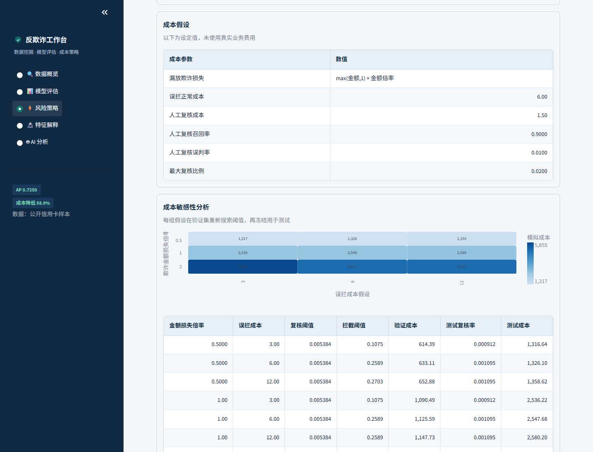

<div align="center">

# 交易反欺诈识别与风险决策

信用卡交易反欺诈离线实验：SQL 画像、时间滚动验证、概率校准与三段风险决策看板

[](pyproject.toml)
[](dashboard.py)
[](sql_analysis.py)
[](tests/)
[](pyproject.toml)

[在线演示](https://fraudriskintermediate-bhchmyg9q2x5er9pewqgju.streamlit.app/) · [快速开始](#快速开始) · [实验流程](#实验流程) · [看板与结果复盘](#看板与结果复盘) · [数据与决策口径](#数据与决策口径) · [完整报告 JSON](reports/latest.json) · [业务分析](docs/业务分析报告.md) · [面试问答](docs/面试问答与简历要点.md)

</div>

---

做反欺诈如果只停在算一个 ROC-AUC，离实际风控决策还差不少步骤：欺诈样本往往只有千分之几，训练时加了类别权重会把模型输出的概率尺度拉偏，而且人工审核团队每天能接的单量是有上限的。

这个仓库基于 ULB 公开信用卡交易数据集（284,807 笔交易，492 笔欺诈，跨度约 48 小时），把模型评分往后的决策链路跑通了一遍。流程上先用 MySQL 做数据质量核对与画像，按唯一时间戳切分滚动窗口比较模型，再用冻结模型的历史留出分做概率校准，最后在复核容量约束下搜索「放行 / 复核 / 拦截」双阈值，并通过中文 Streamlit 看板展示。最后 15% 时间段只作测试；涉及的赔付金额权重、审核准确率和容量上限都是事先写明的离线假设。

| 测试集指标 | 结果 | 口径说明 |
| :--- | :--- | :--- |
| 平均精确率 (AP) | **0.7250** | 95% Bootstrap 区间 `[0.6037, 0.8348]` |
| ROC-AUC | **0.9359** | 95% Bootstrap 区间 `[0.8855, 0.9750]` |
| Brier 技能分 | **60.22%** | 测试 Brier `0.000489`，常数基线 Brier `0.001230`；历史校准段常数概率为 `0.0805%` |
| 冻结策略模拟成本 | **2,547.68** | 相比「全部放行」假设 (`6,194.80`) 低 **58.87%** |
| 测试集复核率 | **0.109%** | 43,838 笔中 48 笔人工复核、40 笔直接拦截（容量上限设为 2%） |

### 几个防踩坑的设计

时序实验里最容易出问题的是时间泄漏和校准错位。这里规定同一秒的交易不跨集合拆分，每个滚动训练窗口内部继续按时间切成拟合、早停、校准三段：标准化器只在拟合段学均值方差，XGBoost 只看内部早停段定树数，概率校准只拿同一个冻结模型在校准段的输出分来拟合。

双阈值搜索也没有用固定步长粗扫。把验证集全部唯一概率排序后，靠前缀和做 `O(1)` 区间成本查询，再用单调队列维护满足人工复核容量上限的最优起点，整体复杂度 `O(n log n)`（4.8 万行验证集单次实测约 0.16 秒），测试目录里有和暴力穷举对账的用例。

## 快速开始

需要 Python 3.10 或更高版本。以下命令均在项目根目录执行。

### 1. 直接打开结果看板

仓库已经提交了跑好的实验报告（`reports/latest.json`）和小时画像（`reports/hour_profile.csv`），不用先装数据库或下载原始 CSV，装完依赖就能直接打开看板：

也可以直接访问部署好的 [Streamlit 在线演示](https://fraudriskintermediate-bhchmyg9q2x5er9pewqgju.streamlit.app/)。

```bash
python -m pip install -r requirements.txt
python run.py dashboard
```

浏览器打开终端显示的地址，左侧可以切换数据概览、模型比较、风险策略、特征解释和 AI 风控分析。看板只读已有文件，不会触发训练。

<details>
<summary>PyCharm 运行配置</summary>

新建 Python 运行配置：脚本选项目根目录下的 `run.py`，参数填 `dashboard`，工作目录设为项目根目录，解释器选装好 `requirements.txt` 的 Python 环境。

</details>

### 2. 用 MySQL 跑一遍合成样本

手头没有原始数据时，可以用合成样本检查流程。请先启动 MySQL 并按下一节设置 `.env`；训练与合成演示均使用 MySQL，输出到单独目录不会覆盖正式报告：

```bash
python run.py demo --output-dir reports/demo
```

合成数据只用来检查代码流程通不通，跑出来的数字不能当成真实数据结论；默认看板仍然读取 `reports/` 下的公开数据报告。

### 3. 用 MySQL 和 Kaggle 原始数据重训

所有数据分析与训练统一使用 MySQL 8.0+：

1. 启动本地 MySQL，把 [`.env.example`](.env.example) 复制为 `.env`，填入 `MYSQL_HOST`、`MYSQL_PORT`、`MYSQL_USER`、`MYSQL_PASSWORD` 和 `MYSQL_DATABASE`（`.env` 已加入 `.gitignore`）。
2. 从 [Kaggle — Credit Card Fraud Detection](https://www.kaggle.com/datasets/mlg-ulb/creditcardfraud) 下载 `creditcard.csv` 放到 `data/` 目录。如果文件不存在程序会直接报错，不会自动替换成合成数据。
3. 执行重训（默认覆盖 `reports/`，想保留已有报告可加 `--output-dir`）：

```bash
python run.py train --data data/creditcard.csv --trees 160
```

## 实验流程

[](docs/images/fraud-analysis-flow.png)

MySQL 先汇总最大训练段的缺失值、完全重复行、金额分位数和相对小时欺诈率，避免把验证/测试标签带入画像。随后按唯一交易时间划出 `40%–55%`、`55%–70%`、`70%–85%` 三个扩展验证窗口，对比类别加权逻辑回归和 XGBoost，并做金额特征消融。

选定模型后保持权重不变，用它在历史校准段的留出预测拟合校准器，在后续验证集敲定校准方案并搜出复核与拦截阈值。模型、校准器和两个阈值全部固定后，才在最后 15% 测试集算一次结果。流程图里把验证策略与测试评估画成两条分支，是为了区分各自职责，测试集数字不反向参与调参。

## 看板与结果复盘

下面 7 张图截自当前看板，对应 [`reports/latest.json`](reports/latest.json)，点击图片可看原图。[`screenshots.source.json`](docs/images/screenshots.source.json) 里记录了对应的报告 SHA-256。

### 1. 数据概览与 SQL 画像

[](docs/images/dashboard-overview.png)

全量 284,807 笔交易里有 492 笔欺诈（约 0.173%）。最终外层训练、验证、测试集分别为 192,974、47,995、43,838 笔，同一秒的记录不会拆到两个集合里。左下图是校准后的测试集风险分直方图，右下图是从数据起点计时的相对小时欺诈率及 Wilson 置信区间。

[](docs/images/dashboard-sql.png)

MySQL 核对结果只统计最大训练段：缺失值 0 个，完全重复副本 705 行（其中欺诈副本 18 行）。正常交易和欺诈交易的均值分别是 89.43 和 116.42，中位数分别为 22.90 和 11.40。少数大额盗刷拉高了欺诈均值，实际上不少欺诈是小额试探单，只看平均金额容易误判。主实验保留了原始重复行，同时在报告里补充了测试集去重敏感性对照。

### 2. 模型比较与概率校准

[](docs/images/dashboard-models.png)

逻辑回归（LR）和 XGBoost 给相同的调参预算（每种金额写法各 3 组预设超参数），三个时间窗口的验证 AP 如下：

| 验证窗口 | 欺诈率基线 AP | 类别加权逻辑回归 AP | 类别加权 XGBoost AP |
| :--- | ---: | ---: | ---: |
| `40%–55%` | 0.0021 | 0.7059 | 0.7942 |
| `55%–70%` | 0.0013 | 0.6695 | 0.7567 |
| `70%–85%` | 0.0012 | 0.7652 | 0.7920 |
| 三窗口均值 ± 标准差 | — | `0.7135 ± 0.0483` | `0.7810 ± 0.0210` |

单看平均验证 AP 是 XGBoost 更高，但在离测试集最近的 `70%–85%` 窗口里，`LR − XGBoost` 的配对 AP 差值 95% 区间为 `[-0.1071, 0.0352]`，跨过了 0。按实验前定下的选型规则，差值区间含 0 时优先用结构更简单的逻辑回归（仅保留 `Amount` 原值，`C=10`）。需要注意，这条规则只是工程选型约定，不等于证明两个模型效果相同。

基础模型冻结后，在它的历史校准段分数上拟合不同校准方法，再到验证集比较：

| 验证校准方案 | 验证 Brier | 分位箱 ECE | 备注 |
| :--- | ---: | ---: | :--- |
| 未校准 | 0.031695 | 0.076543 | 类别加权改变了概率尺度 |
| 跨窗口 Platt（仅对照） | 0.000429 | 0.000323 | 混用不同基础模型的历史分数，不参与选择 |
| 同模型 Platt（选定） | **0.000460** | 0.000405 | 同一冻结模型校准段拟合 |
| 同模型 Isotonic | 0.000465 | 0.000262 | 保序回归对照 |
| 先验截距校正 | 0.001248 | 0.003120 | 仅调整基率先验，不参与最终选择 |

最终采用同模型 Platt。测试集 Brier 为 0.000489，相对历史校准段常数概率 0.0805% 对应的常数基线 Brier 0.001230，Brier 技能分为 **60.22%**。如果把验证集锁定的复核阈值当作告警线，测试集告警精确率为 46.59%、召回率为 75.93%（这里的告警包含进入人工复核和直接拦截两部分，不代表全部直接拒付）。

### 3. 金额特征消融

[](docs/images/dashboard-ablation.png)

很多做法默认对金额取对数，这里固定选定超参数，把 2 类模型 × 3 种金额写法（`Amount`、`LogAmount`、两者同时输入）× 3 个验证窗口共 18 组结果列出来直接比对。

对逻辑回归来说，原值和对数相关性很高，同时放进去会影响标准化系数的稳定性，所以最终候选只保留单一金额表达，这次实验里原值 `Amount` 表现更好。对 XGBoost 来说，单调对数变换在单列切分点上排序一致，而两列同时输入可能改变列采样过程，具体差异可直接看看板里的 18 行明细表。

### 4. 风险策略、成本敏感性与误差分析

[](docs/images/dashboard-policy.png)

验证集搜出并冻结的复核阈值为 `0.0053836`，拦截阈值为 `0.2588658`。放到 43,838 笔测试集上的处置分布：

| 处置动作 | 笔数 | 占测试集比例 |
| :--- | ---: | ---: |
| 放行 | 43,750 | 99.799% |
| 人工复核 | 48 | 0.109% |
| 直接拦截 | 40 | 0.091% |

测试复核率 0.109%，低于预设的 2% 容量上限；模拟总成本为 **2,547.68**，比全部放行（6,194.80）低 **58.87%**。

页面下方的 9 组成本敏感性实验分别改动了欺诈金额损失倍率和误拦成本。每一组假设都在验证集重新跑双阈值搜索，再冻结到测试集算账，所以表里能看到阈值和复核率随成本假设一起变动，而不是拿原结果简单乘倍率。页面同时展示期望损失策略对照：容量影子价格只在验证集搜索，测试集固定复用该值；由于校准段正例很少导致概率低估，它当前作为金额敏感的诊断对照，不替代冻结双阈值策略。

按告警线统计，测试集有 13 笔漏判、47 笔误报。漏放金额最高的三笔（1,096.99、634.30、357.95）加起来占了全部漏放损失的 **88.03%**。在金额加权口径下，总损失很容易被少数几笔大额样本左右，不能只看错判笔数。

### 5. 特征解释

[](docs/images/dashboard-features.png)

当前逻辑回归的标准化系数绝对值排名前五的是 `V6`、`V24`、`V4`、`Amount` 和 `V14`。因为公开数据里的 `V1`–`V28` 是脱敏后的 PCA 主成分，没法还原成设备、商户或地域含义；系数大小也只反映模型层面的统计关联，不能直接当成业务上的盗刷原因。

### 6. AI 风控分析

[](docs/images/dashboard-ai.png)

看板最后一页读取当前报告里的模型对比、测试指标、成本参数和特征系数，用来生成文字解读并附上引用的报告字段。没配接口时默认走上图这种本地离线摘要；在 `.env` 或 Streamlit Secrets 里填好兼容 OpenAI Chat Completions 的地址和密钥后，可以切到在线问答。

请求只发裁剪后的汇总指标，不传原始 CSV 或逐笔标签。同一浏览器会话里切页不会重复发请求，报告更新后会自动清掉旧回答。助手只做报告解读，不改阈值也不参与拦截，配置细节见 [运行与部署说明](docs/运行与部署.md)。

## 数据与决策口径

### 输入字段与时间切分

原始表要求无缺失、数值有限，`Class` 为 0（正常）或 1（欺诈），数据来源与 SHA-256 记录在 [`data/creditcard.source.json`](data/creditcard.source.json)。外层和内层都按唯一 `Time`（距起点的秒数）比例切分，因此时间比例与实际交易笔数比例不完全相等：

```text
全量 284,807 笔（按唯一 Time 升序，同秒交易不拆开）
├── 滚动验证窗口：40%–55% | 55%–70% | 70%–85%
├── 最终训练段（0%–70%，192,974 笔）
│   ├── 拟合段：141,938 笔（学标准化器与基础模型参数）
│   ├── 早停段： 19,989 笔（仅决定树模型早停轮数）
│   └── 校准段： 31,047 笔（冻结模型，拟合 Platt / Isotonic）
├── 最终验证段（70%–85%，47,995 笔）──> 选校准器 + 搜索双阈值
└── 最终测试段（85%–100%，43,838 笔）──> 冻结评估
```

### 策略动作与成本公式

校准后概率低于复核阈值时放行，介于复核阈值与拦截阈值之间转人工复核，达到拦截阈值直接拦截。搜索和评估共用同一个 `CostParameters` 参数对象：

```text
模拟成本 = 漏放欺诈金额加权损失（单笔金额下限取 1）
         + 预计误拦正常笔数 × 6
         + 人工复核笔数 × 1.5
```

人工复核假设欺诈召回率 90%、正常交易误判率 1%，复核容量上限为验证集单量的 2%。人工复核漏掉或误判的期望损失也算在里面，所以分项预计笔数会出现小数。容量约束只在验证集选阈值时卡住，后续时段如果高分段交易变多仍可能超限；模拟成本只跟「全部放行」比，不代表替换线上现有风控规则后的净收益。

## IEEE-CIS 扩展代码

除了上面跑完真实数据的 ULB 实验，仓库还写好了接入 **IEEE-CIS Fraud Detection** 数据的管道与实验脚本：

- 合并交易表和身份表，记录输入文件哈希，用 `card1`、`addr1` 和推导的首笔相对日拼出近似 `uid`，输出质量检查。
- 用 MySQL 窗口查询为卡、地址、邮箱、设备和近似用户生成历史统计特征，排除同一秒并列记录与未来记录；`sql/ieee_temporal_features.sql` 是 5 条手写演示子集，完整特征由 `ieee_pipeline.py` 动态生成。
- 假设 7 天标签成熟延迟（拟合、早停、校准、目标编码和验证选型都留足 7 天间隔），按相对月对比 WOE 评分卡、LightGBM 和 XGBoost，输出分组消融、PSI 漂移和 SHAP。

**IEEE-CIS 原始 CSV 受 Kaggle 比赛规则约束，不随仓库分发。本机已下载两份官方训练文件，保存在 Git 忽略的 `data/ieee/`，并完成真实 590,540 行全量特征与滚动实验。** 三个月验证集分别为 92,189、98,615、64,922 笔，独立测试月为 92,427 笔；最终选定 XGBoost（`max_depth=5`），测试 AP **0.4499**、ROC-AUC **0.8705**、Brier **0.024019**、ECE **0.007573**。报告、特征筛选和分组消融见 [`reports/ieee/`](reports/ieee/)；本次正式运行使用 160 棵树、每类 3 个候选、1,000 次 Bootstrap，并显式跳过 SHAP 以控制内存。其他环境需先在 [Kaggle 比赛数据页](https://www.kaggle.com/competitions/ieee-fraud-detection/data)接受规则并下载 `train_transaction.csv`、`train_identity.csv`，运行方式见 [IEEE 数据与实验说明](docs/IEEE数据与实验.md)。

## 目录说明

```text
fraud_risk_intermediate/
├── run.py                      # 命令行入口（dashboard / train / demo / ieee-*）
├── fraud_model.py              # 时间切分、滚动验证、概率校准与双阈值搜索
├── experiments.py              # 模型比较、金额消融、成本敏感性与误差统计
├── sql_analysis.py             # MySQL 数据质量核查与画像查询
├── sql/                        # 探索 SQL 与 IEEE 时序窗口演示子集
├── dashboard.py                # 中文 Streamlit 看板
├── ai_assistant.py             # 报告字段提取、离线摘要与兼容接口问答
├── ieee_pipeline.py            # IEEE 数据合并、近似 uid 与窗口特征生成
├── ieee_experiments.py         # IEEE 按相对月评估、WOE/PSI 与 SHAP 导出
├── reports/
│   ├── latest.json             # 当前公开数据的实验报告与前端图表分箱
│   └── hour_profile.csv        # 相对小时交易量、欺诈率、Wilson 区间与金额统计
├── docs/                       # 业务报告、部署说明、IEEE 说明与面试问答
└── tests/                      # 60 项测试（穷举成本对照、时间与标签隔离、看板回归等）
```

训练生成的逐笔预测文件 `reports/test_scores.csv` 不进版本控制；看板直接读 `latest.json` 里的预计算分箱就能画出全部图表。

## 测试与检查

```bash
python -m ruff check .
python -m pytest -q -p no:cacheprovider
```

目前共 60 项测试全部通过，ruff 检查通过；真实 IEEE 全量实验已生成 `reports/ieee/ieee_report.json`。完整特征生成仍需要本地或容器里的 MySQL 8.0+，GitHub Actions 只执行合成演示和回归测试，本地执行记录见 [修改执行记录](docs/修改执行记录.md)。

## 已知局限

- ULB 数据只有约 48 小时，测试集仅 54 笔欺诈，Bootstrap 置信区间较宽，不能当成跨月稳定性结论。
- 每类模型每种金额表达只试了 3 组预设参数，属于固定预算对比；同一个验证段同时用来选校准方案和搜双阈值，存在多重比较影响。
- 当前流程从训练集尾部切出了 31,047 笔做独立校准，基础模型拟合样本量与旧版不同。当前 ROC-AUC（0.9359）低于旧报告，不能把 AP 或 Brier 的变化单独归因于某一项修改。
- 匿名 PCA 字段没法做业务归因；赔付倍率与审核准确率都是固定假设，不能直接等同于线上财务表现。

## 参考与文档

- 项目文档：[业务分析报告](docs/业务分析报告.md) · [运行与部署](docs/运行与部署.md) · [IEEE 数据与实验](docs/IEEE数据与实验.md) · [面试问答与讲稿](docs/面试问答与简历要点.md)
- 数据集：[Kaggle — Credit Card Fraud Detection](https://www.kaggle.com/datasets/mlg-ulb/creditcardfraud)
- 参考资料：[Fraud Detection Handbook](https://github.com/Fraud-Detection-Handbook/fraud-detection-handbook)（不平衡评估与时间验证）、[Made With ML](https://github.com/GokuMohandas/Made-With-ML)（工程与测试组织）
