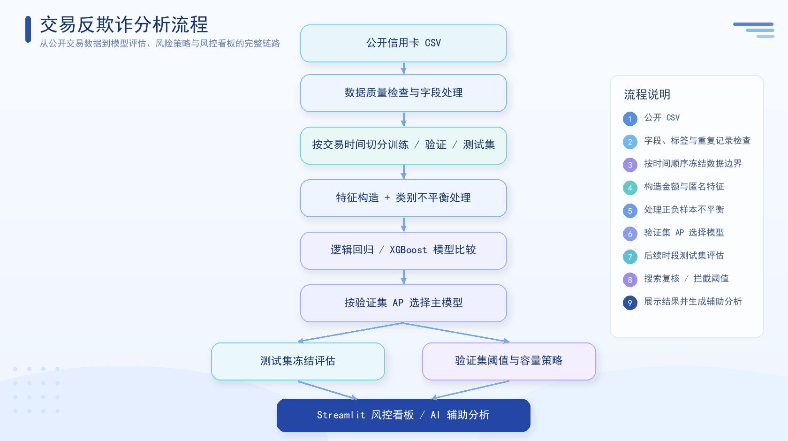
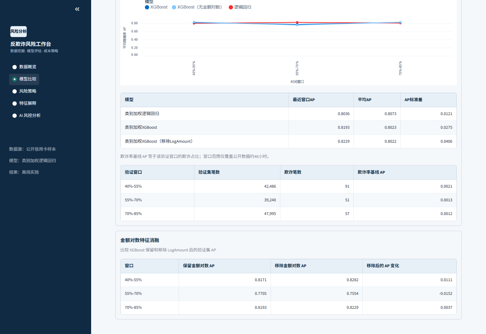
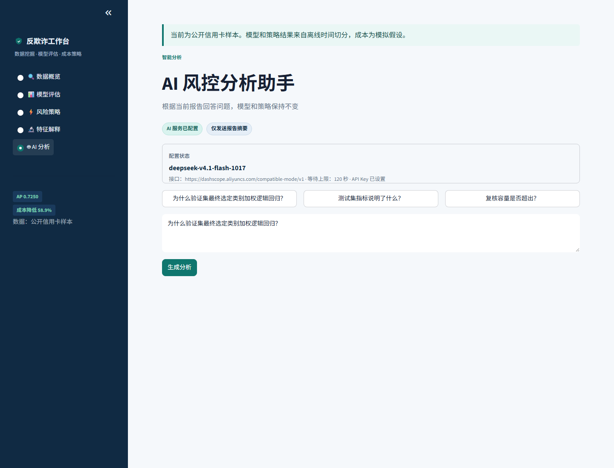

# 交易反欺诈数据挖掘与风险决策

基于公开信用卡交易数据，用 **MySQL 数据画像、时间滚动验证、概率校准与成本策略**，完成从交易分析到放行、复核、拦截的离线实验。项目提供中文 Streamlit Demo，展示数据质量、模型比较、风险策略、特征解释及 AI 辅助分析。

当前真实实验使用 ULB 的 **284,807 笔交易**，其中 **492 笔欺诈**，数据跨度约 48 小时。模型在历史窗口选择，最后 15% 仅用于测试；费用、复核效果和容量均为明确设定的演示假设。

| 核心结果 | 当前测试集 |
| --- | --- |
| 平均精确率 AP | **0.7250**，95% 区间 [0.6037, 0.8348] |
| ROC-AUC | **0.9359**，95% 区间 [0.8855, 0.9750] |
| Brier 技能分 | **60.22%**，相对历史发生率常数基线 |
| 冻结策略模拟成本 | **2,547.68**，较全部放行假设低 **58.87%** |

[查看完整实验报告](reports/latest.json) · [业务分析报告](docs/业务分析报告.md) · [运行与部署说明](docs/运行与部署.md)

## 快速开始

需要 Python 3.10 或更新版本。以下命令在项目根目录执行：

```bash
python -m pip install -r requirements.txt
```

仓库已包含实验报告、小时画像及图表分箱，可直接打开 Demo，无需先下载原始数据或启动数据库：

```bash
python run.py dashboard
```

浏览器打开终端显示的本地地址。左侧可切换 **数据概览、模型比较、风险策略、特征解释、AI 风控分析**。看板读取已有报告，不会自动训练。

在 PyCharm 中，新建 Python 运行配置：脚本选择 `run.py`，参数填写 `dashboard`，工作目录选择项目根目录，解释器选择已安装项目依赖的 Python 环境。

### 重新训练

真实数据训练默认使用 **MySQL 8.0+**。先启动 MySQL，复制 [连接配置模板](.env.example) 为 `.env`，填写 `MYSQL_HOST`、`MYSQL_PORT`、`MYSQL_USER`、`MYSQL_PASSWORD` 和 `MYSQL_DATABASE`。实际密码仅保存在被 Git 忽略的本地配置中。

从 [Kaggle — Credit Card Fraud Detection](https://www.kaggle.com/datasets/mlg-ulb/creditcardfraud) 下载 `creditcard.csv`，放入 `data/`，运行：

```bash
python run.py train --data data/creditcard.csv --trees 160
```

没有原始数据或 MySQL 服务时，可以运行合成数据 Demo：

```bash
python run.py demo --sql-backend duckdb --output-dir reports/demo
```

训练默认覆盖 `reports/` 中的报告与逐笔分数；`--output-dir` 可指定独立实验目录。上面的合成演示写入 `reports/demo/`，不会替换公开数据报告；默认看板仍读取 `reports/`。合成数据只用于检查流程，不能作为真实数据效果。

## 分析流程

[](docs/images/fraud-analysis-flow.png)

MySQL 首先汇总缺失、重复、金额分布和相对小时欺诈率；随后按唯一交易时间构造三个扩展验证窗口，比较逻辑回归和 XGBoost，并做金额特征消融。每个训练窗口内部再分为模型拟合、早停和校准三段。

模型选定后，用同一冻结模型的历史留出预测拟合校准器，在后续验证集选择校准方案与双阈值策略。**模型、校准方案和策略阈值确定后，才对最终测试集评估**。图中的测试评估与验证策略两条分支表示不同职责，测试结果不反向参与选择。最终报告由看板和可选 AI 助手读取。

## Demo 展示与结果分析

以下截图均来自当前 Demo 和仓库中的 [最新报告](reports/latest.json)，点击图片可查看原图。[截图来源记录](docs/images/screenshots.source.json) 保存了报告哈希；AI 助手截图展示当前报告的离线摘要模式。

### 1. 数据概览与 SQL 画像

[](docs/images/dashboard-overview.png)

数据共有 **284,807 笔交易、492 笔欺诈，欺诈率约 0.173%**。最终外层训练、验证和测试分别为 **192,974、47,995、43,838 笔**，同一时间戳不会跨集合。风险分数直方图展示校准后的测试分数；小时曲线展示相对时间上的欺诈比例及 Wilson 区间。

[](docs/images/dashboard-sql.png)

MySQL 核对结果为缺失值 **0 个**、重复副本 **1,081 行**，其中 **19 行**为欺诈副本。正常与欺诈交易的金额中位数分别为 **22.00、9.25**，均值分别为 **88.29、122.21**。均值与中位数方向不同，说明金额分布偏斜，不能仅用平均金额概括典型交易。

当前保留原始重复行，另做测试集去重敏感性分析。图中的“相对小时”从数据起点计时，不代表真实钟点。

### 2. 模型比较与概率校准

[](docs/images/dashboard-models.png)

LR 与 XGBoost 各使用三个预设超参数候选，分别比较金额原值、对数金额及两者同时输入。XGBoost 只在训练内部的早停段决定树数；每个标准化器只在拟合段学习参数。

| 验证窗口 | 欺诈率基线 AP | 类别加权逻辑回归 AP | 类别加权 XGBoost AP |
| --- | ---: | ---: | ---: |
| 40%-55% | 0.0021 | 0.7059 | 0.7942 |
| 55%-70% | 0.0013 | 0.6695 | 0.7567 |
| 70%-85% | 0.0012 | 0.7652 | 0.7920 |

| 模型 | 三窗口平均 AP | AP 标准差 | 最近窗口 AP |
| --- | ---: | ---: | ---: |
| 类别加权逻辑回归 | 0.7135 | 0.0483 | 0.7652 |
| 类别加权XGBoost | 0.7810 | 0.0210 | 0.7920 |

XGBoost 的平均验证 AP 更高，但最近窗口 **LR − XGBoost** 的配对 AP 差值 95% 区间为 **[-0.1071, 0.0352]**。按预设规则，区间含 0 时优先选择更简单的 LR；这一规则不等于证明两种模型效果相同。

最终选择 **仅保留 Amount 的类别加权逻辑回归，C=10**。同一冻结模型在历史校准段产生分数，分别拟合 Platt 和 Isotonic，再按后续验证集 Brier 选择；校准后不重新训练基础模型。

| 验证校准方案 | Brier | 分位箱 ECE |
| --- | ---: | ---: |
| 未校准 | 0.031695 | 0.076543 |
| 跨窗口Platt（仅对照） | 0.000429 | 0.000323 |
| 同模型Platt | 0.000460 | 0.000405 |
| 同模型Isotonic | 0.000465 | 0.000262 |

跨窗口 Platt 仅作诊断对照，不参与最终选择，因为它使用不同基础模型产生的分数。最终使用 **同模型 Platt**；测试 Brier 为 **0.000489**，历史校准段发生率常数基线为 **0.001230**，Brier 技能分为 **60.22%**。

测试 AP 为 **0.7250**、ROC-AUC 为 **0.9359**。以验证集冻结的复核阈值作为告警阈值，精确率为 **46.59%**、召回率为 **75.93%**；此处“告警”包含进入复核和直接拦截，不等同于全部直接拒绝交易。

### 3. 金额特征消融

[](docs/images/dashboard-ablation.png)

消融覆盖 **两种模型 × 三种金额表达 × 三个验证窗口**，固定各自选定超参数，单独比较特征表达的影响。LR 的最终候选只保留一种金额表达，避免原值与对数同时输入对系数稳定性的影响；完整 18 行结果保留在报告和页面中。

当前实验选择原始金额，没有把“取对数”直接当成必然有效的特征。XGBoost 中单调变换的金额原值与对数在本次实验可能产生相同排序结果，组合输入又可能改变列采样过程，应结合实际对照解释。

### 4. 风险策略与成本敏感性

[](docs/images/dashboard-policy.png)

复核阈值 **0.0053836**、拦截阈值 **0.2588658** 在验证集确定后冻结。测试处置结果为：

| 处置 | 笔数 |
| --- | ---: |
| 放行 | 43,750 |
| 人工复核 | 48 |
| 直接拦截 | 40 |

测试复核率为 **0.109%**，低于假设的 **2%** 容量上限。按下文费用和审核效果设定，模拟成本为 **2,547.68**，较全部放行的 **6,194.80** 低 **58.87%**。

九组敏感性假设分别改变欺诈金额损失倍率和误拦成本。**每组都在验证集重新搜索阈值，然后冻结用于测试**，因此表格同时呈现阈值、复核率和成本的变化，而不只是对原成本乘一个倍率。

按告警阈值统计，测试有 **13 笔漏判、47 笔误报**。漏放损失最高的三笔金额为 **1,096.99、634.30、357.95**，合计贡献约 **88.03%** 的漏放损失。成本对少数大额样本敏感，不能只看漏判笔数。

### 5. 特征解释

[](docs/images/dashboard-features.png)

当前逻辑回归的标准化系数绝对值中，**V6、V24、V4、Amount 和 V14** 排名前列。页面展示全局关联强度，金额特征的作用另通过消融比较。

`V1`–`V28` 是 PCA 转换后的匿名特征，不能还原成设备、商户或地域。系数或重要性也不能证明交易被判定为欺诈的业务原因。

### 6. AI 风控分析

[](docs/images/dashboard-ai.png)

助手读取模型比较、测试指标、成本假设和特征重要性，按问题生成解释并展示报告依据。上图为 **当前报告的离线摘要**，可在未配置模型服务时直接体验；配置兼容接口后可使用在线问答。

回答在当前浏览器会话中保留，切换页面不会重复请求；重新生成会替换回答，报告变化后旧回答会清除。助手不训练模型、不修改策略、不执行拦截；配置方式见 [运行与部署](docs/运行与部署.md)。

## 数据、训练与决策口径

### 输入与时间切分

| 字段 | 含义 |
| --- | --- |
| `Time` | 相对起点的秒数，用于时间切分和分布统计 |
| `Amount` | 交易金额 |
| `V1`–`V28` | 匿名主成分特征 |
| `Class` | 0 为正常、1 为欺诈 |

原始数据须为无缺失的有限数值，标签为 0/1。来源与 SHA-256 见 [数据来源记录](data/creditcard.source.json)。原始 CSV 不纳入版本控制，文件缺失时会明确报错，不会自动替换为合成数据。

外层按唯一时间戳构造 **40%–55%、55%–70%、70%–85%** 三个扩展验证窗口，最后 **85%–100%** 为测试。训练段内部再按唯一时间戳分为拟合、早停与校准段，最终分别为 **141,938、19,989、31,047 笔**；时间戳比例不等于交易笔数比例。

### 策略成本

| 分数区间 | 动作 |
| --- | --- |
| 低于复核阈值 | 放行 |
| 达到复核阈值，低于拦截阈值 | 人工复核 |
| 达到拦截阈值 | 拦截 |

```text
模拟成本 = 漏放欺诈金额加权损失（每笔金额下限为 1）
         + 预计误拦正常笔数 × 6
         + 人工复核笔数 × 1.5
```

人工复核召回率假设为 **90%**、正常交易误判率为 **1%**，复核容量为 **2%**。复核错误也计入预计损失，因此相关笔数可能为小数。参数由统一成本对象驱动搜索与评估。

阈值候选覆盖验证集全部唯一分数；排序为 O(n log n)，前缀和与单调队列扫描为 O(n)。容量在验证集选择时约束，后续时段仍可能超限。模拟成本仅与“全部放行”比较，不代表相较现有线上风控系统的收益。

## IEEE-CIS 扩展

保留 ULB 作为当前可复现实验，并提供 IEEE-CIS 的数据接入与实验入口：

- 合并交易和身份表，记录来源哈希，构造近似 uid 并输出质量检查。
- 用 MySQL 为卡、地址、邮箱、设备、近似用户生成 57 项历史与相对时间特征，排除同刻和未来记录。
- 按训练段拟合 WOE/IV、计算 PSI，比较 WOE 评分卡、LightGBM、XGBoost，输出分组消融、漂移对照和 SHAP。
- 拟合、校准、目标编码及策略选择遵守 7 天标签成熟延迟假设，最后相对月只测试。

**本地尚无 IEEE-CIS 原始数据，目前只完成合成样本的流程验收，没有真实 IEEE 特征收益或月度效果。** 数据准备、运行命令与验收边界见 [IEEE 数据与实验说明](docs/IEEE数据与实验.md)。

## 项目结构与输出

| 文件或目录 | 作用 |
| --- | --- |
| [run.py](run.py) | 看板、公开数据训练、合成演示及 IEEE 命令入口 |
| [fraud_model.py](fraud_model.py) / [experiments.py](experiments.py) | 时间切分、模型比较、校准、成本策略及报告生成 |
| [sql_analysis.py](sql_analysis.py) / [sql/](sql/) | MySQL 数据质量、金额画像与历史窗口查询 |
| [dashboard.py](dashboard.py) | 中文 Streamlit Demo |
| [ai_assistant.py](ai_assistant.py) | 报告上下文、离线摘要及可选在线问答 |
| [ieee_pipeline.py](ieee_pipeline.py) / [ieee_experiments.py](ieee_experiments.py) | IEEE 数据接入、特征处理和按相对月实验 |
| [reports/latest.json](reports/latest.json) | 当前公开数据的完整实验报告与图表分箱 |
| [reports/hour_profile.csv](reports/hour_profile.csv) | 小时交易量、欺诈比例、Wilson 区间与金额统计 |
| `reports/test_scores.csv` | 本地生成的逐笔测试标签和分数，不纳入版本控制 |
| [tests/](tests/) | 成本穷举对照、时间与标签隔离、SQL 一致性及看板回归 |
| [业务分析报告](docs/业务分析报告.md) | 模型、策略、误差与建议 |
| [面试问答与讲稿](docs/面试问答与简历要点.md) | 可核实的简历表述、问答及五分钟讲稿 |
| [运行与部署](docs/运行与部署.md) | PyCharm、MySQL、AI 配置及 Cloud 部署 |

## 验证

```bash
python -m ruff check .
python -m pytest -q -p no:cacheprovider
```

当前实现已通过 **53 项测试** 和 ruff 检查。SQL 集成与 IEEE 窗口测试需要 MySQL；合成流程不需要下载原始信用卡 CSV。具体执行证据见 [修改执行记录](docs/修改执行记录.md)。CI 已配置 MySQL 和免服务演示两条路径，远端运行状态需在发布后核验。

## 当前限制

- 数据仅覆盖约 48 小时，测试只有 54 笔欺诈，Bootstrap 区间较宽，不能视为跨月稳定性结论。
- 每类模型只有三个预设候选，属于有限预算比较；同一验证段参与方案与阈值选择，存在多重比较影响。
- 本次训练留出了独立校准段，拟合样本量与旧实验不同。当前 ROC-AUC 低于旧报告，不能把 AP 或 Brier 的变化归因于某一项修复。
- 匿名 PCA 特征限制业务解释；完全重复记录保留，仅补充评估敏感性分析。
- 成本和审核效果依赖固定假设，不代表线上收益；IEEE 的相对日/月也不等于真实日历时间。

## 数据来源与参考

- [Kaggle — Credit Card Fraud Detection](https://www.kaggle.com/datasets/mlg-ulb/creditcardfraud)：当前真实实验数据。
- [Fraud Detection Handbook](https://github.com/Fraud-Detection-Handbook/fraud-detection-handbook)：反欺诈评估、不平衡学习与时间验证参考。
- [Made With ML](https://github.com/GokuMohandas/Made-With-ML)：训练、测试与工程组织参考。
