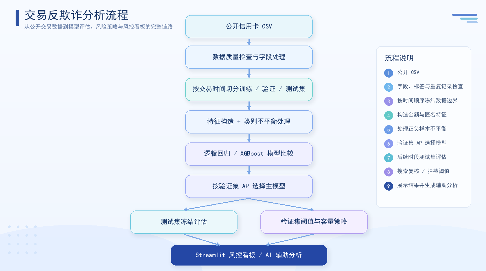
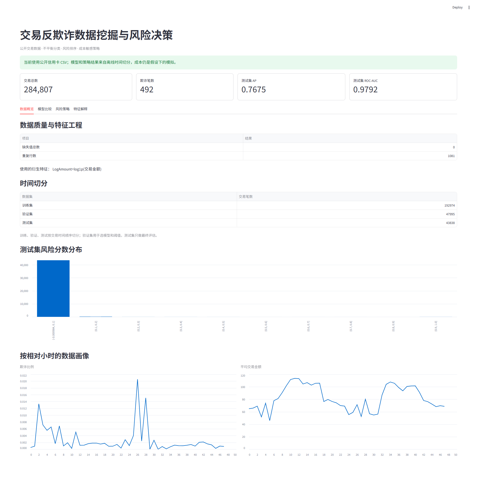
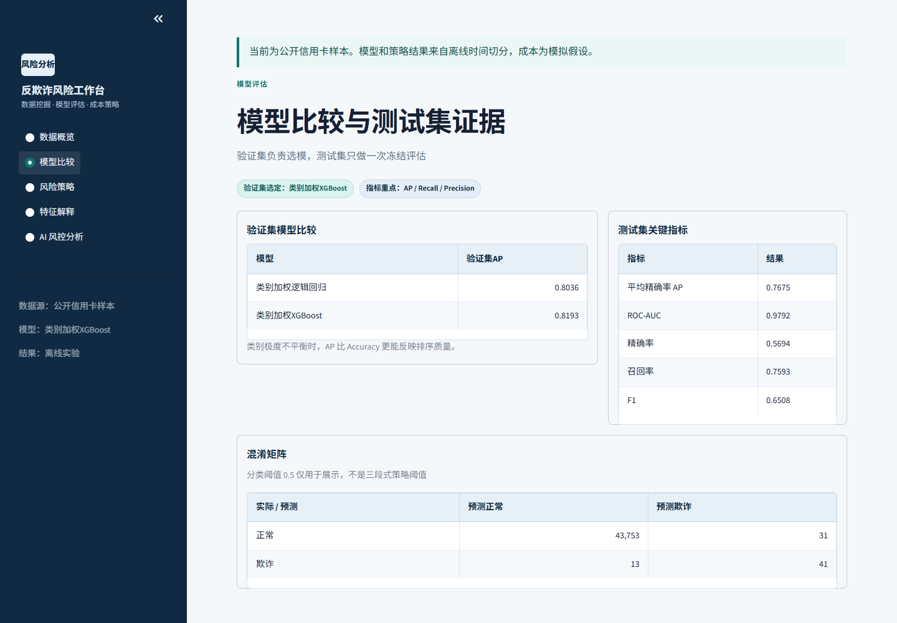
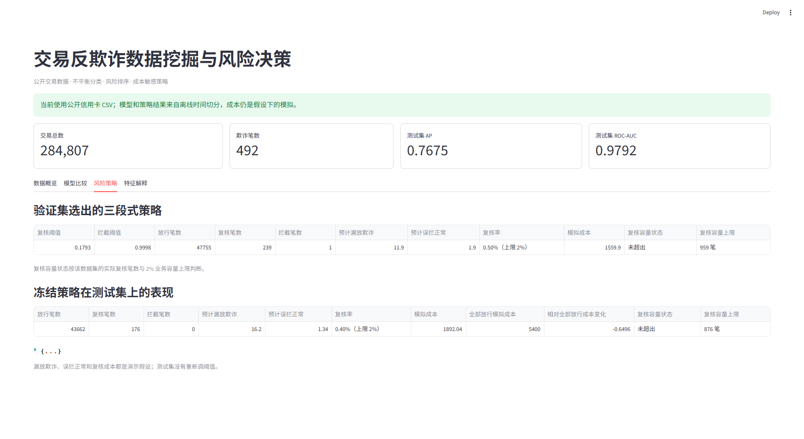
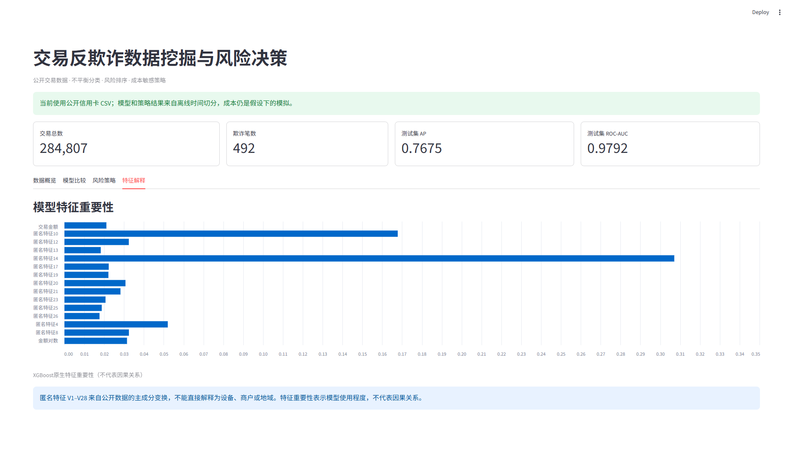
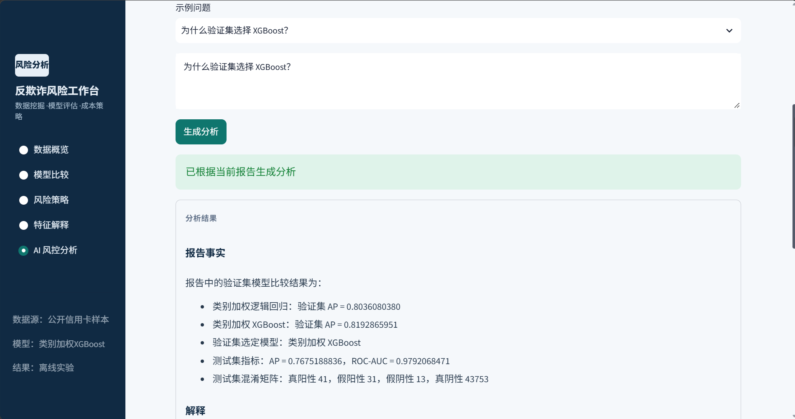

# 交易反欺诈数据挖掘与风险决策

> 面向风控与反欺诈实习的端到端实验项目：在极度不平衡的交易数据上比较模型，以时间顺序冻结评估，并将风险分数转化为受人工复核容量约束的决策策略。

<p><a href="#快速开始"></a>&nbsp;&nbsp;<a href="#模型与评估设计"></a>&nbsp;&nbsp;<a href="#项目展示与结果分析"></a>&nbsp;&nbsp;<a href="#模型与评估设计"></a></p>

## 项目概览

本项目基于公开信用卡交易数据，比较类别加权逻辑回归与 XGBoost
对欺诈交易的识别效果，并将风险分数转化为**放行、人工复核、拦截**三种决策。项目重点不是单纯追求分类指标，而是把模型验证、阈值选择、复核容量和成本假设放在同一套可复现流程中分析。

核心内容：

-   **数据质量检查：** 检查字段、标签、重复记录和数据来源信息。
-   **时间顺序切分：**
    按交易时间划分训练集、验证集和测试集，同一时间戳不跨集合。
-   **不平衡分类：** 比较类别加权逻辑回归和使用 `scale_pos_weight` 的
    XGBoost。
-   **模型选择：** 以验证集 AP
    选择模型，并在后续时间段测试集上冻结评估。
-   **风险策略：** 在验证集选择复核与拦截阈值，考虑复核容量和模拟成本。
-   **可解释性展示：** 查看所选模型的全局特征重要性，并说明匿名 PCA
    特征的解释边界。
-   **结果看板与 AI 辅助：** 使用中文 Streamlit 看板呈现实验；AI
    只解释结构化报告，不修改模型或策略。

> **重要边界：**
> 本项目的成本、复核准确性和误判率是明确设定的模拟假设。离线模拟成本下降不等于线上收益，也不能解释为相较现有风控系统的提升。

## 分析流程



流程图对应一次完整运行：公开信用卡 CSV 先经过字段、标签和重复记录检查，再按交易时间冻结训练、验证和测试边界；特征构造与类别不平衡处理后比较逻辑回归和 XGBoost，依据验证集 AP 选择模型。测试集只用于后续时段评估，复核与拦截阈值在验证集单独搜索，并受复核容量和模拟成本约束。最终结果进入 Streamlit 风控看板，AI 只解释结构化报告，不改变模型、阈值或动作。

## 目录

-   [项目概览](#项目概览)
-   [分析流程](#分析流程)
-   [项目展示与结果分析](#项目展示与结果分析)
-   [快速开始](#快速开始)
-   [使用公开信用卡数据](#使用公开信用卡数据)
-   [模型与评估设计](#模型与评估设计)
-   [风险决策与成本假设](#风险决策与成本假设)
-   [AI 风控分析助手](#ai-风控分析助手)
-   [项目结构与输出](#项目结构与输出)
-   [测试](#测试)
-   [使用限制与后续改进](#使用限制与后续改进)
-   [数据来源与参考资料](#数据来源与参考资料)

## 项目展示与结果分析

以下四张截图来自 **2026-10-25** 实际运行的 Streamlit 看板，对应
`reports/latest.json` 的公开信用卡 CSV
训练报告。重新训练后，请同步检查截图和下文的结果是否仍与报告一致。

### 1. 数据概览：样本结构与验证边界

[](./docs/images/dashboard-overview.png)

数据共包含 284,807 笔交易，其中 492 笔欺诈，占比约
**0.173%**，属于极度不平衡分类任务。单看准确率容易掩盖欺诈漏报，因此项目使用
AP 评估风险排序，并同时报告精确率、召回率等指标。

训练集、验证集和测试集分别为 192,974、47,995、43,838
笔；相同时间戳不会跨集合。数据审计发现 1,081
行完全重复记录，本版本保留原始行并披露该问题。相对小时画像由相对时间计算，不代表真实钟点。风险分数集中在低分区也不能单独证明模型有效，更不能将未校准分数视为真实欺诈概率。

### 2. 模型比较：验证集选择，后续时间段测试

[](./docs/images/dashboard-models.png)

| 验证集模型 | AP |
| --- | ---: |
| 类别加权逻辑回归 | 0.8036 |
| 类别加权 XGBoost | 0.8193 |

本次实验按验证集 AP 选择 XGBoost，两者相差约
**0.0157**。该差异来自一次固定时间切分，不能据此断言 XGBoost
在所有时段都更优。

冻结模型后，测试集 AP 为 **0.7675**，ROC-AUC 为
**0.9792**。在用于分类展示的固定阈值 `0.5` 下，54 笔欺诈中识别出 41
笔、漏报 13 笔，另有 31 笔正常交易被误报；Precision 为
**56.94%**，Recall 为 **75.93%**。较高的 ROC-AUC
不意味着没有误报和漏报，实际决策仍需独立评估阈值策略。测试集 AP
低于验证集，也提示后续需要更多时间窗口验证稳定性。

### 3. 风险策略：受复核容量约束的离线模拟

[](./docs/images/dashboard-policy.png)

两个策略阈值只使用验证集选择。应用到测试集后，冻结策略放行 **43,662
笔**、人工复核 **176 笔**、直接拦截 **0 笔**。复核率为 **0.40%**，低于
**2%** 上限；测试集最多允许复核 876 笔，页面显示"未超出"。复核队列中包含
42 笔欺诈，但人工复核召回率仍按假设的 90%
计算，不能将其视为全部成功拦截。

测试集直接拦截为 0 笔，是因为测试集最高风险分数约为
`0.9998228`，未达到验证集冻结的拦截阈值约
`0.9998300`。三段式策略并不保证每个后续时段都产生三类动作；本次没有根据测试集结果重新降低阈值。

按漏放损失 100、误拦成本 6、复核成本
1.5，以及既定复核效果计算，模拟成本为 **1,892.04**，较"全部放行"的
**5,400.00** 下降
**64.96%**。这是与全部放行基线的离线模拟比较，不代表相较现有风控系统的提升，也不代表线上资金收益。

### 4. 特征解释：模型依赖与解释边界

[](./docs/images/dashboard-features.png)

本次模型中，匿名特征 **V14、V10、V4**
的原生重要性较高，金额对数特征也进入前 15
项。该结果用于检查模型依赖的变量，不能证明单个特征一定带来性能提升；验证特征贡献仍需要消融实验。

`V1`--`V28` 是经过 PCA
转换的匿名特征，不能直接解释为设备、商户、地域或真实欺诈原因。本页展示的是全局特征重要性，没有进行单笔交易归因，也不能作为因果分析。

### 5. AI 风控分析：把结构化报告整理成可读结论



AI 页面读取当前 `latest.json` 中的验证集 AP、测试集指标、复核容量、模拟成本和特征重要性，生成一段可追溯的中文摘要，并在页面底部列出使用的依据字段。截图中的结论对应当前公开信用卡实验：验证集 AP 为 0.819，测试集 AP 为 0.768，复核 176 笔、占比 0.40%，模拟成本较全部放行基线下降 64.96%。

该页面只负责解释已有报告，不重新训练模型、不调整阈值、不执行放行或拦截。未配置远程接口时使用离线摘要；配置兼容接口后，AI 仍只接收裁剪后的结构化报告，不上传原始 CSV 全量数据或测试集逐行标签。

## 快速开始

### 环境要求

-   Python 3.10 或更新版本
-   项目依赖见 `requirements.txt`
-   公开信用卡 CSV（训练时需要）
-   不配置 AI 服务也可以运行看板和离线摘要

### Streamlit Community Cloud 部署

- 主文件选择 `dashboard.py`。提交 `requirements.txt` 和 `reports/` 下已纳入版本控制的示例报告，看板即可读取报告展示结果。
- 图表依赖固定为 `altair==6.2.2` 和 `streamlit==1.61.1`，与本地验证版本一致。不要改成 Altair 5.4.1：该版本被此版本的 Streamlit 明确排除，会导致安装失败和依赖解析长时间回溯。
- 本地开发环境为 Python 3.10。云端版本在 **Advanced settings → Python version** 中选择；更换已有应用的 Python 版本需重新部署，`runtime.txt` 或 **Reboot app** 不能代替该操作。
- 更新 GitHub 中的依赖文件后，在 Cloud 查看新的构建日志；需要重试构建时点击 **Reboot app**。依赖安装成功后才会启动页面，本地通过不代表云端已经部署成功。

以下命令均在项目根目录执行。

### 1. 安装依赖

``` bash
python -m pip install -r requirements.txt
```

### 2. 运行公开数据实验

``` bash
python run.py train --data data/creditcard.csv --trees 160
```

训练逻辑回归和 XGBoost，并将报告写入 `reports/`。当前实验的结果保存在
`reports/latest.json`；具体产物见[项目结构与输出](#项目结构与输出)。

**注意：** 训练会覆盖 `reports/latest.json`、`reports/test_scores.csv`
和
`reports/hour_profile.csv`。如需保留不同实验，请先备份已有报告。更换数据后重新训练，再刷新看板。

### 3. 启动结果看板

``` bash
python run.py dashboard
```

看板读取 `reports/`
中已有报告，不会在打开页面时自动训练。若报告尚未生成，请先运行训练命令。

看板包含"数据概览""模型比较""风险策略""特征解释""AI
风控分析"五个模块。当前版本采用浅色风控工作台布局，包含左侧工作区导航、顶部实验状态、风险语义色、复核容量进度和中文证据表格；图表与表格使用统一的浅色主题样式。

### 4. 流程自检（可选）

如果暂时没有公开数据，可运行：

``` bash
python run.py demo --rows 12000 --trees 80
```

该命令使用合成数据检查流程是否可运行，结果**只用于功能自检，不用于简历成果或模型效果结论**。

## 使用公开信用卡数据

从 [Kaggle --- Credit Card Fraud
Detection](https://www.kaggle.com/datasets/mlg-ulb/creditcardfraud) 下载
`creditcard.csv`，放入 `data/` 目录。项目不自动下载数据，原始 CSV
不纳入版本控制。

当前报告对应的数据来源、下载地址和 SHA-256 记录在
[`data/creditcard.source.json`](data/creditcard.source.json)。

### 字段说明

| 字段 | 含义 |
| --- | --- |
| `Time` | 相对起始交易的秒数，用于时间切分和相对时间画像 |
| `Amount` | 交易金额 |
| `V1`--`V28` | 匿名主成分特征 |
| `Class` | 标签：`0` 为正常交易，`1` 为欺诈交易 |

特征列必须可转换为数值且无缺失，标签必须为 `0` 或
`1`。按时间切分后的训练集、验证集和测试集均需包含两类交易。数据文件缺失时程序会报错，不会自动替换为合成数据。

## 模型与评估设计

### 数据切分与特征

按 `Time` 排序，以唯一时间戳的 70% 和 85%
位置划定训练集、验证集、测试集。同一时间戳的交易保留在同一个集合，因此各集合的交易笔数不一定恰好为
70%、15%、15%。

模型使用 `Amount`、`LogAmount = log1p(max(Amount, 0))` 和
`V1`--`V28`，共 30 个特征。标准化器只在训练集拟合；`Time`
不参与模型训练。相对小时画像由 `Time // 3600` 计算，不能解释为真实钟点。

### 模型设置

| 模型 | 不平衡处理 | 主要设置 |
| --- | --- | --- |
| 逻辑回归 | `class_weight="balanced"` | 最多迭代 1,000 次 |
| XGBoost | 训练集负类数 / 正类数作为 `scale_pos_weight` | 深度 4、学习率 0.08，树数由 `--trees` 指定 |

### 评估规则

1.  使用验证集 AP（平均精确率）比较模型并选择模型。
2.  冻结所选模型，在后续时间段的测试集上报告
    AP、ROC-AUC、Precision、Recall、F1 和混淆矩阵。
3.  分类指标使用固定阈值 `0.5`，仅用于常规分类性能展示。
4.  风险策略的复核与拦截阈值独立在验证集选择，不能与 `0.5`
    分类阈值混为一谈。
5.  特征解释对应最终选定模型：逻辑回归展示标准化系数绝对值，XGBoost
    展示原生特征重要性。

AP 对极度不平衡任务下的正类识别与排序更有参考价值，但仍应与
Precision、Recall、混淆矩阵和业务约束共同解读。一次时间切分不能证明模型长期稳定；应使用多个时间窗口进一步验证。

## 风险决策与成本假设

### 三段式决策

| 风险分数区间 | 决策 |
| --- | --- |
| 低于复核阈值 | 放行 |
| 达到复核阈值、低于拦截阈值 | 人工复核 |
| 达到拦截阈值 | 拦截 |

程序在验证集分数的候选分位点中搜索两个阈值，要求复核和拦截区间均非空，且复核比例不超过
2%，再选择模拟成本最低的组合。阈值在验证集确定后保持冻结，用于后续测试集；不会根据测试集结果重新调整。

### 模拟成本

``` text
模拟成本 = 预计漏放欺诈笔数 × 100
         + 预计误拦正常笔数 × 6
         + 人工复核笔数 × 1.5
```

当前默认假设：

-   漏放欺诈的单笔成本：100
-   误拦正常交易的单笔成本：6
-   人工复核的单笔成本：1.5
-   人工复核召回率：90%
-   正常交易误判率：1%
-   复核容量约束：验证集上不超过 2%

预计漏放和误拦会同时考虑复核错误，因此成本计算中的笔数可能是小数。这些数值是用于演示决策方法的固定假设，并非来自真实业务财务数据。

**容量约束的边界：** 2%
是在验证集选择策略时使用的约束。测试集或未来数据上的复核比例仍可能超过
2%；本次测试集复核比例为
0.40%。策略也不保证每个时间段都产生直接拦截动作。

## AI 风控分析助手

看板的"AI风控分析"页用于解释当前报告中的指标、模型比较、复核容量和模拟成本。它只读取结构化报告，不训练模型、不修改阈值、不执行拦截。

### 离线模式

未配置 AI
服务时，点击"生成分析"会使用离线中文摘要，因此项目不依赖远程模型也可以运行。

### 配置 OpenAI 兼容服务（可选）

在项目根目录 `.env` 中填写兼容的 Chat Completions
服务配置，启动看板时会自动读取。系统环境变量优先级高于 `.env`：

``` powershell
$env:AI_BASE_URL = "https://your-compatible-endpoint/v1"
$env:AI_MODEL = "your-model-name"
$env:AI_API_KEY = "your-api-key"
python run.py dashboard
```

`.env` 示例：

``` dotenv
AI_BASE_URL="https://your-compatible-endpoint/v1"
AI_MODEL="your-model-name"
AI_API_KEY="your-api-key"
AI_TIMEOUT_SECONDS="120"
```

`AI_TIMEOUT_SECONDS` 控制模型响应等待时间，默认 90 秒，允许范围 10--300
秒。`AI_API_KEY`
不写入代码或报告；不需要密钥的本地兼容服务可以留空。保留示例占位符时会使用离线摘要，不会发起请求。关闭
AI 时，删除或清空 `.env` 中的配置，再启动看板即可。

AI 上下文只包含报告摘要、模型指标、策略结果、成本假设和前 15
个特征重要性，不上传原始 CSV
全量内容或测试集逐行标签。回答会附带使用的报告字段，并说明成本假设与匿名
PCA 特征的解释边界。

## 项目结构与输出

| 文件或目录 | 作用 |
| --- | --- |
| [`run.py`](run.py) | `demo`、`train`、`dashboard` 命令入口 |
| [`fraud_model.py`](fraud_model.py) | 特征构造、时间切分、模型比较、策略搜索与报告导出 |
| [`dashboard.py`](dashboard.py) | 中文结果看板 |
| [`ai_assistant.py`](ai_assistant.py) | 结构化报告上下文、AI 问答、离线摘要与异常回退 |
| `data/` | 公开信用卡 CSV 存放目录 |
| [`data/creditcard.source.json`](data/creditcard.source.json) | 数据来源、下载地址和 SHA-256 记录 |
| [`tests/`](tests/) | 时间切分、成本计算、策略约束和 AI 回退测试 |
| `reports/latest.json` | 数据检查、模型指标、决策阈值、模拟成本与特征解释 |
| `reports/test_scores.csv` | 测试集标签和风险分数 |
| `reports/hour_profile.csv` | 相对小时交易量、欺诈比例和平均金额 |

## 测试

测试使用小规模合成数据，无需下载信用卡 CSV。在项目根目录运行：

``` bash
python -m pytest -q
```

## 使用限制与后续改进

### 当前限制

-   **成本是假设值：**
    漏放、误拦和复核成本及复核准确性均为固定假设，模拟成本不代表真实资金损失或线上收益。
-   **分数未经概率校准：**
    类别加权模型输出应作为风险排序分数使用，不应直接当作真实欺诈概率。
-   **时间稳定性尚未充分验证：**
    当前主要结果来自一次固定时间切分，仍需更多时间窗口评估模型和策略稳定性。
-   **匿名特征限制业务解释：** PCA
    特征无法直接映射到商户、设备、地域等真实业务字段。
-   **重复记录被保留：** 当前发现 1,081
    行完全重复记录，本版本保留原始行并披露该数据质量问题，没有静默去重。
-   **演示数据不代表真实效果：**
    合成数据只用于流程自检，不应用于简历中的实际效果结论。

### 可继续改进的方向

1.  在更多滚动时间窗口上验证模型排序、阈值和复核容量的稳定性。
2.  在有真实业务标签与成本数据的前提下，重新估计漏放、误拦及复核成本。
3.  对风险分数进行概率校准，并评估校准前后对阈值策略的影响。
4.  使用真实复核反馈分析复核队列质量，而不只依赖固定的复核效果假设。
5.  在具备可解释原始交易字段的场景下补充单笔解释与特征消融实验。

以上为后续方向，不代表当前版本已经实现。

## 数据来源与参考资料

-   [Kaggle --- Credit Card Fraud
    Detection](https://www.kaggle.com/datasets/mlg-ulb/creditcardfraud)：项目使用的公开信用卡交易数据。
-   [Fraud Detection
    Handbook](https://github.com/Fraud-Detection-Handbook/fraud-detection-handbook)：信用卡反欺诈可复现实验手册，涵盖评估指标、模型选择与不平衡分类。
-   [Made With
    ML](https://github.com/GokuMohandas/Made-With-ML)：机器学习项目环境、训练、评估和测试文档参考。
