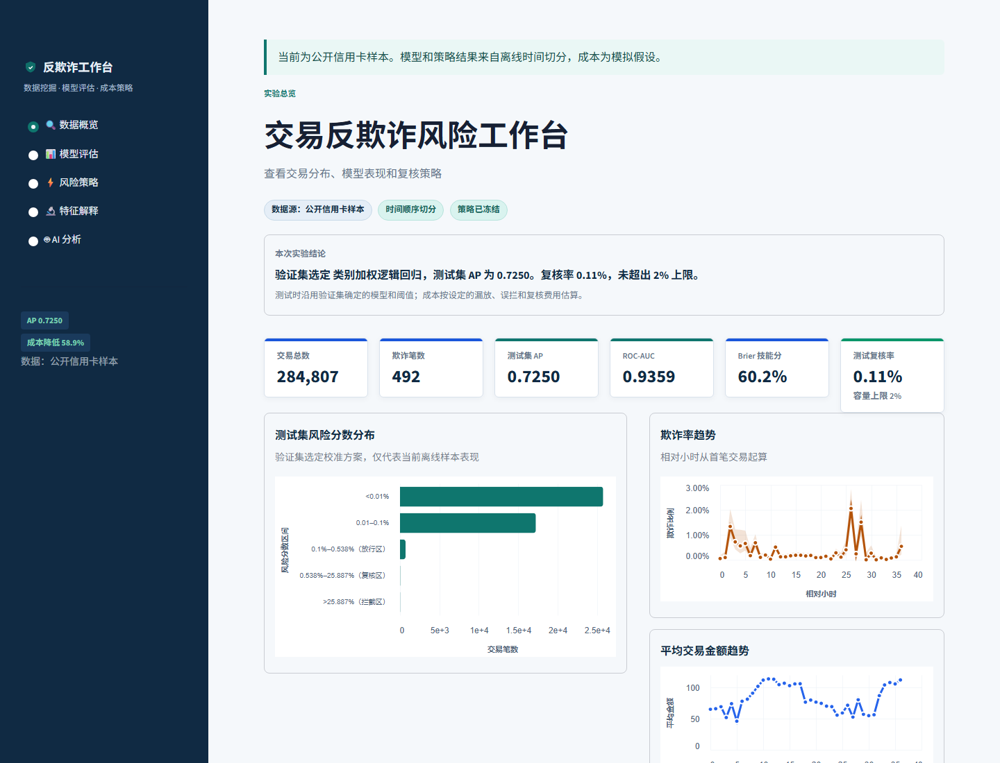
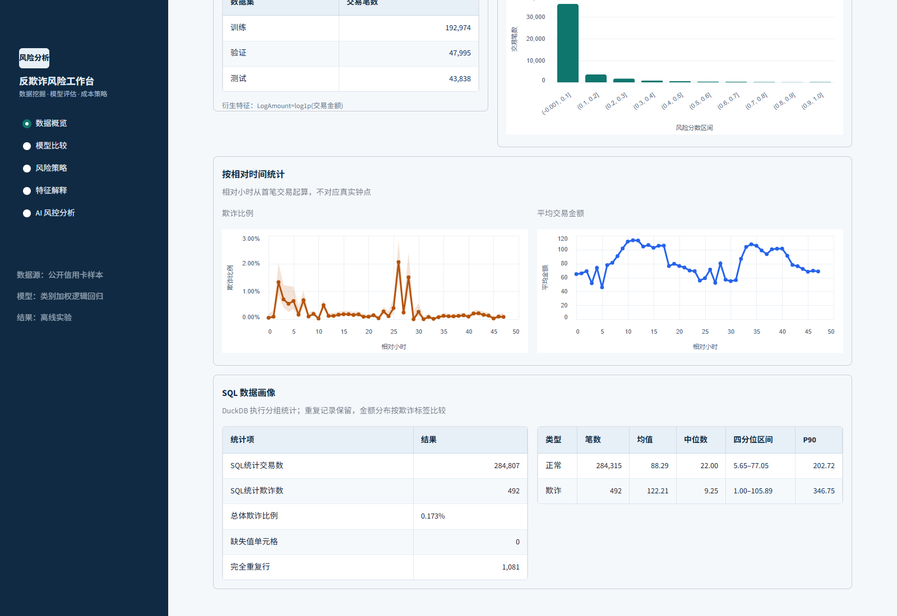
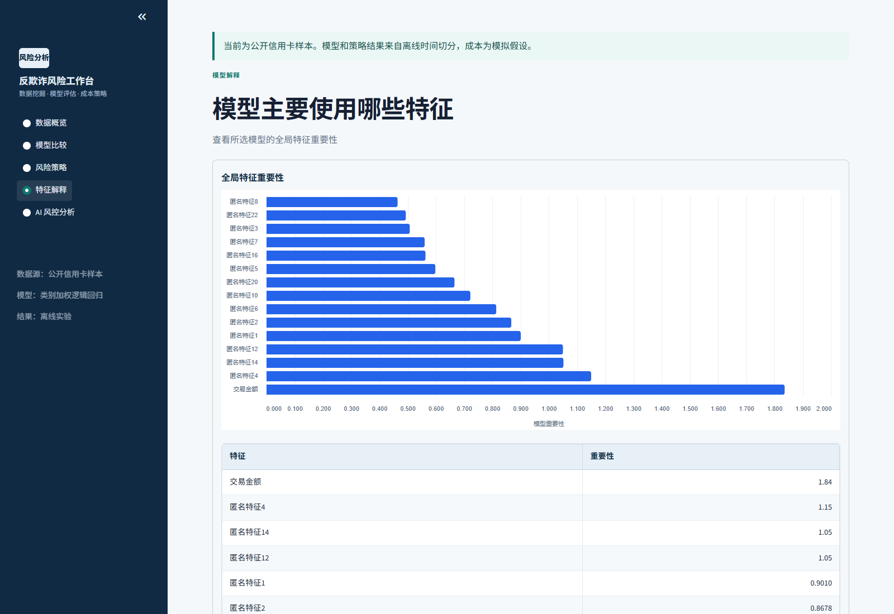

# 交易反欺诈数据挖掘与风险决策

围绕公开信用卡反欺诈数据，使用 DuckDB SQL 完成数据画像与分组统计，再以时间窗口比较模型、检验金额特征，并评估放行、复核和拦截策略。数据约 48 小时，策略成本按明确假设离线模拟。

项目包含训练脚本、中文 Streamlit 看板，以及根据实验报告回答问题的 AI 助手。模型与策略均在本地离线评估，成本按设定值计算。

## 快速开始

需要 Python 3.10 或更新版本。以下命令均在项目根目录执行。

```bash
python -m pip install -r requirements.txt
```

仓库已包含一份公开信用卡数据的实验报告，可以直接打开看板，无需先下载数据或训练：

```bash
python run.py dashboard
```

浏览器打开终端显示的本地地址。左侧可以切换数据概览、模型比较、风险策略、特征解释和 AI 风控分析。看板读取已有报告，不会自动训练。

在 PyCharm 中，可新建 Python 运行配置：脚本选择 `run.py`，参数填写 `dashboard`，工作目录选择项目根目录，解释器使用已安装依赖的 Python 环境。训练时把参数改为 `train --data data/creditcard.csv --trees 160` 即可。

### 重新训练

从 [Kaggle — Credit Card Fraud Detection](https://www.kaggle.com/datasets/mlg-ulb/creditcardfraud) 下载 `creditcard.csv`，放入 `data/`，再运行：

```bash
python run.py train --data data/creditcard.csv --trees 160
```

没有数据时，也可以用合成样本检查流程：

```bash
python run.py demo --rows 12000 --trees 80
```

**这两条命令都会覆盖 `reports/latest.json`、`reports/test_scores.csv` 和 `reports/hour_profile.csv`，需要保留原实验时请先备份。** 合成样本只用于功能自检，不能用来报告公开数据上的模型效果。训练完成后刷新看板即可。

## 分析流程


先由 DuckDB SQL 汇总交易规模、缺失与重复、金额分位数和相对小时欺诈率；欺诈率按小时附 Wilson 95% 区间。再按交易时间设置三个扩展验证窗口，比较类别加权逻辑回归、XGBoost 与欺诈率基线 AP。模型以三个验证窗口 AP 均值选择，金额对数特征消融也只在验证窗口比较。最后 15% 数据保留作唯一测试集，策略阈值取最近验证窗口并冻结。报告供看板和 AI 助手读取。

## 项目展示与结果分析

以下页面截图和指标对应仓库中的 [`reports/latest.json`](reports/latest.json)。重新训练后，应按生成报告重新核对截图和数值。

### 数据概览

[](docs/images/dashboard-overview.png)

数据共有 284,807 笔交易，其中 492 笔欺诈，占比约 **0.173%**。最后时间切分的训练集、验证集和测试集分别为 192,974、47,995、43,838 笔，同一时间戳不会跨集合。概览页展示 DuckDB SQL 得出的金额分布、数据质量和按小时欺诈率区间。

数据检查发现 1,081 行完全重复记录，当前保留原始行。图中的“相对小时”从首笔交易起算，不是真实钟点。风险分数未经概率校准，不能直接解释成欺诈概率。



### 模型比较

[](docs/images/dashboard-models.png)

滚动验证各窗口 AP 如下，欺诈率基线等于该窗口的欺诈占比：

| 验证窗口 | 欺诈率基线 AP | 类别加权逻辑回归 AP | 类别加权 XGBoost AP |
| -------- | -------------:| -------------------:| -------------------:|
| 40%–55%  | 0.0021        | 0.7975              | 0.8171              |
| 55%–70%  | 0.0013        | 0.8208              | 0.7705              |
| 70%–85%  | 0.0012        | 0.8036              | 0.8193              |

逻辑回归三个窗口 AP 均值为 **0.8073**（标准差 **0.0121**），XGBoost 均值为 **0.8023**（标准差 **0.0275**）。因此按预先约定的均值指标选择逻辑回归；单看最近窗口则 XGBoost AP 略高，说明模型排序表现会随时间段变化。

测试集上，逻辑回归 AP 为 **0.7152**、ROC-AUC 为 **0.9773**。固定分类阈值 `0.5` 下，54 笔欺诈中识别出 46 笔、漏报 8 笔；同时有 1,143 笔正常交易被标为欺诈，精确率为 **3.87%**、召回率为 **85.19%**。这说明排序指标较高不等于默认阈值可直接用于业务拦截。

三窗口结果只覆盖约 48 小时的公开数据，用于展示短期时间变化，不能视为长期稳定性结论。

金额对数特征消融结果：

| 验证窗口 | 保留 LogAmount AP | 移除 LogAmount AP | 移除后的 AP 变化 |
| -------- | -----------------:| -----------------:| ----------------:|
| 40%–55%  | 0.8171            | 0.8282            | +0.0111          |
| 55%–70%  | 0.7705            | 0.7554            | -0.0152          |
| 70%–85%  | 0.8193            | 0.8229            | +0.0037          |

效果方向并不一致，因此保留这项对照，不把单个窗口的差异包装成普遍收益。


### 风险策略

[](docs/images/dashboard-policy.png)

复核和拦截阈值在验证集确定，应用到测试集后保持不变：

| 测试集处置 | 笔数   |
| ---------- | ------:|
| 放行       | 43,658 |
| 人工复核   | 170    |
| 直接拦截   | 10     |

复核率为 **0.39%**，低于 **2%** 上限；按测试集规模折算，容量上限为 876 笔。复核队列包含 34 笔欺诈，成本计算仍按人工复核召回率 90% 估算，预计会有漏判；直接拦截的 10 笔中有 9 笔欺诈。

直接拦截阈值约为 `1.0000000`，只有达到该阈值的交易被拦截；后续时段不一定出现全部三类动作，本次没有为增加拦截量而重调阈值。

按下文的费用和复核效果假设，模拟成本为 **1,709.16**，较全部放行的 **5,400.00** 低 **68.35%**。比较对象是全部放行，结果不代表相较现有风控系统的提升，也不是线上资金收益。

### 特征解释

[](docs/images/dashboard-features.png)

所选逻辑回归的标准化系数绝对值中，交易金额、V4 和 V14 排名前列。这里展示的是全局关联强度，不能说明欺诈原因；金额对数的贡献另由时间窗口消融表比较。

`V1`–`V28` 是 PCA 转换后的匿名特征，无法还原成设备、商户或地域。重要性反映模型对变量的使用程度，不说明欺诈原因。

### AI 风控分析

AI 助手读取模型比较、测试集指标、策略结果、成本假设和前 15 项特征重要性，并列出回答所依据的报告字段。回答内容取决于当前报告和所配置的模型服务。

AI 只负责解释已有结果，不参与训练或策略执行。当前浏览器会话会保留最近一次回答，切换工作区后返回仍可查看，且不会重复请求接口。重新生成会替换旧回答，训练报告变化后旧回答会清除；关闭会话或服务重启后不保留。未配置服务时使用离线摘要；配置方法见下文。

## SQL 分析与数据口径

`sql/fraud_eda.sql` 使用 DuckDB 对内存中的交易表执行分组查询，覆盖整体规模、完全重复行、欺诈与正常交易金额均值/中位数/四分位数/90分位数，以及相对小时的交易量、欺诈数和平均金额。小时欺诈率及 Wilson 95% 区间由 Python 根据 SQL 分组计数计算。

本次 SQL 核对结果：284,807 笔、492 笔欺诈、缺失值 0 个、完全重复 1,081 行。金额中位数分别为正常交易 **22.00**、欺诈交易 **9.25**；均值分别为 **88.29** 和 **122.21**。中位数与均值方向不同，说明金额分布偏斜，均值不能单独代表典型交易。重复行按原数据保留，未假定它们都是无效记录。

## 数据与模型

### 输入数据

| 字段       | 含义                                     |
| ---------- | ---------------------------------------- |
| `Time`     | 距首笔交易的秒数，用于时间切分和分布统计 |
| `Amount`   | 交易金额                                 |
| `V1`–`V28` | 匿名主成分特征                           |
| `Class`    | `0` 为正常交易，`1` 为欺诈交易           |

特征列必须可转换为数值且无缺失，标签必须为 `0` 或 `1`；三个验证窗口的训练段、验证段及最后测试段都需同时包含两类交易。文件不存在时程序会报错，不会自动替换为合成数据。原始 CSV 不纳入版本控制，当前报告所用文件的来源、下载地址和 SHA-256 见 [`data/creditcard.source.json`](data/creditcard.source.json)。

### 切分、特征与训练

按唯一 `Time` 排序，以 40%、55%、70%、85% 和 100% 的位置构造三个扩展训练/验证窗口，最后一个 85%–100% 区间作为唯一测试集。所有切分都以唯一时间戳为边界，同一时刻不会跨集合。

模型使用 `Amount`、`LogAmount = log1p(max(Amount, 0))` 和 `V1`–`V28`，共 30 个特征。`Time` 不参与训练；相对小时由 `Time // 3600` 计算。标准化器只在训练集拟合，再转换验证集和测试集。

| 对比项 | 逻辑回归 | XGBoost |
| --- | --- | --- |
| 不平衡处理 | `class_weight="balanced"` | 训练集负类数 / 正类数作为 `scale_pos_weight` |
| 主要设置 | 最多迭代 1,000 次 | 深度 4、学习率 0.08，树数由 `--trees` 指定 |

每个窗口独立拟合标准化器和模型，只在相应训练段拟合变换。候选包括类别加权逻辑回归、类别加权 XGBoost，以及移除 `LogAmount` 的 XGBoost 消融版本。模型按三个窗口 AP 均值选择，并报告样本标准差（ddof=1）；欺诈率基线用于衡量不使用特征排序时的参考水平。测试集只用于最后一次评估，分类指标仍以固定阈值 `0.5` 展示，并与策略阈值分开。

解释页随选定模型展示不同结果：逻辑回归使用标准化系数绝对值，XGBoost 使用原生特征重要性。

## 风险决策与成本假设

| 风险分数区间               | 处置     |
| -------------------------- | -------- |
| 低于复核阈值               | 放行     |
| 达到复核阈值、低于拦截阈值 | 人工复核 |
| 达到拦截阈值               | 拦截     |

在最近的验证窗口（70%–85%）分数候选分位点中搜索两个阈值，要求复核和拦截区间均非空、复核比例不超过 2%，再选择模拟成本最低的组合。阈值冻结后，测试集或未来时段的复核比例仍可能超过上限。

```text
模拟成本 = 预计漏放欺诈笔数 × 100
         + 预计误拦正常笔数 × 6
         + 人工复核笔数 × 1.5
```

人工复核召回率设为 90%，正常交易误判率设为 1%。预计漏放和误拦同时计入复核错误，因此笔数可能为小数。上述费用、复核效果和 2% 容量均为固定假设，未使用真实业务财务数据或审核反馈。

## AI 风控分析助手

### 本地配置

在项目根目录创建 `.env`，填写兼容 Chat Completions 的服务配置：

```dotenv
AI_BASE_URL="https://your-compatible-endpoint/v1"
AI_MODEL="your-model-name"
AI_API_KEY="your-api-key"
AI_TIMEOUT_SECONDS="120"
```

将前三项替换为实际配置后，运行 `python run.py dashboard`，进入“AI 风控分析”并点击“生成分析”。页面显示“AI 服务已配置”只表示读到了配置，收到回答后才说明接口调用成功。调用失败会提示原因并回退到离线摘要。

配置优先级为 **Streamlit Secrets > 系统环境变量 > 本地 `.env`**。响应等待时间默认 90 秒，范围为 10–300 秒。免密接口可以留空 `AI_API_KEY`。保留示例地址或模型名时不会发送请求；要停用 AI，清空当前生效配置源中的 `AI_BASE_URL` 或 `AI_MODEL`。

请求仅包含裁剪后的报告汇总，不发送原始 CSV 或逐行测试标签。真实密钥不应写进代码、报告或 Git 仓库。

### Streamlit Community Cloud 部署

1. 将项目提交到 GitHub，保留 `requirements.txt` 及 `reports/` 中的三份示例结果文件。
2. 在 Cloud 选择仓库和分支，主文件填写 `dashboard.py`；如果项目位于仓库子目录，填写对应的相对路径。
3. 在 **Advanced settings → Python version** 选择 Python 版本，本地验证环境为 Python 3.10。已有应用更换 Python 版本需要重新部署。
4. 按当前 `requirements.txt` 安装依赖，其中图表相关版本为 `altair==6.2.2`、`streamlit==1.61.1`。

本地 `.env` 不会随部署上传。在云端 **Manage app → Settings → Secrets** 填写：

```toml
AI_BASE_URL = "https://你的兼容接口地址/v1"
AI_MODEL = "你的模型名称"
AI_API_KEY = "你的实际密钥"
AI_TIMEOUT_SECONDS = 120
```

配置项放在顶层，不加 `[secrets]` 分组。也可参考 [Secrets 模板](.streamlit/secrets.toml.example)。保存后重新打开应用；配置未生效时再点击 **Reboot app**。

`.env` 和真实 `.streamlit/secrets.toml` 已加入 `.gitignore`，只提交占位符模板。

## 项目结构与输出

| 文件或目录                                                  | 作用                                             |
|:-----------------------------------------------------------:| ------------------------------------------------ |
| [`run.py`](run.py)                                          | `demo`、`train`、`dashboard` 命令入口            |
| [`fraud_model.py`](fraud_model.py)                          | 特征构造、时间切分、模型比较、策略搜索与报告导出 |
| [`sql_analysis.py`](sql_analysis.py) 与 `sql/fraud_eda.sql` | DuckDB SQL 数据质量、金额和时间画像              |
| [`dashboard.py`](dashboard.py)                              | 中文结果看板                                     |
| [`ai_assistant.py`](ai_assistant.py)                        | AI 配置、报告上下文、问答和离线摘要              |
| `data/`                                                     | 本地原始数据及数据来源记录                       |
| [`tests/`](tests/)                                          | SQL 区间估计、滚动切分、消融、成本策略和看板测试 |
| [`reports/latest.json`](reports/latest.json)                | SQL画像、滚动验证、模型指标、策略与特征解释      |
| [`reports/test_scores.csv`](reports/test_scores.csv)        | 测试集标签和风险分数                             |
| [`reports/hour_profile.csv`](reports/hour_profile.csv)      | 相对小时交易量、欺诈比例、Wilson区间和平均金额   |

## 测试

测试使用小规模合成数据，无需下载信用卡 CSV：

```bash
python -m pytest -q
```

## 当前限制

滚动验证窗口来自同一份约 48 小时的数据，不代表跨月或长期稳定性；模型输出未经概率校准。重复行保留，匿名 PCA 特征限制了业务解释。成本与人工复核效果依赖固定假设，不能据此推算线上收益。固定阈值 0.5 下正常交易误报较多，因此该指标不能直接作为线上处置规则。

若继续扩展，应优先寻找含有稳定业务字段和更长时间跨度的数据，并用真实审核反馈校准复核率与成本；本项目未实现线上实验或真实收益评估。

## 数据来源与参考资料

- [Kaggle — Credit Card Fraud Detection](https://www.kaggle.com/datasets/mlg-ulb/creditcardfraud)：本项目使用的数据集。
- [Fraud Detection Handbook](https://github.com/Fraud-Detection-Handbook/fraud-detection-handbook)：反欺诈实验中的评估指标、模型选择和不平衡分类方法。
- [Made With ML](https://github.com/GokuMohandas/Made-With-ML)：机器学习项目的训练、评估与测试组织方式。
